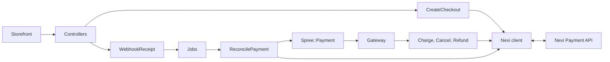

# How the integration works

The engine creates hosted Nexi checkouts and connects them to Solidus payments. It retrieves payment state from Nexi before updating local financial records. Browser returns and webhooks trigger that retrieval.

## Where to look

| Code | Purpose |
| --- | --- |
| `lib/solidus_nexi/nexi` | HTTP transport, money validation, response parsing, state mapping, and webhook authentication. |
| `app/controllers/solidus_nexi` | Checkout creation, returns, and webhook intake. |
| `app/services/solidus_nexi/create_checkout.rb` | Reuse a matching checkout or persist a new payment intent before calling Nexi. |
| `app/services/solidus_nexi/checkout_availability.rb` | Decide whether an existing hosted page can be reused or replaced. |
| `app/services/solidus_nexi/checkout_context.rb` | Check that the serialized order still matches the checkout. |
| `app/services/solidus_nexi/reconcile_payment.rb` | Validate provider identity and update payment state under a payment lock. |
| `app/services/solidus_nexi/reconcile_financial_records.rb` | Add missing capture and refund records under that same lock. |
| `app/services/solidus_nexi/refund_reconciliation.rb` | Match asynchronous refund outcomes to local refund attempts. |
| `app/models/solidus_nexi` | Solidus adapters, payment sources, operation records, and webhook receipts. |
| `app/jobs/solidus_nexi` | Retrieval retries and webhook recovery. |
| `app/views/spree` | Storefront, API, and admin partials. |
| `db/migrate` | Engine tables and indexes. |

## Checkout and identity

Checkout creation locks the order while preparing local records. It releases the lock before the HTTP request. An open checkout can be reused only when the amount and serialized order match. The fingerprint includes item references, descriptions, tax allocation, shipping, currency, and order reference.

Every new checkout has a `PaymentSource` and an `Operation`. The operation records the request fingerprint and any returned provider payment ID. Recovery validates the payment reference, order, currency, amount, and context before binding a recovered identity.

Nexi's 48-hour hosted-page lifetime is not proof that no payment occurred. Replacing an expired page requires a later verified snapshot with no financial activity. A dispatched create with no provider ID remains blocked for investigation. Only an old intent that was never dispatched can be abandoned automatically.

## Mutations and recovery

Charge and refund operations retain one idempotency key for each logical request. Retries must keep the same amount and provider identity. Create and cancellation requests have no provider idempotency key and are not replayed after an uncertain outcome.

A timeout, TLS failure, server error, or malformed successful response can leave the operation `unknown`. A worker crash can leave it `dispatched`; reconciliation also checks dispatched operations older than five minutes. The reconciliation task can recover a checkout ID held only on its operation record.

Refund initiation is asynchronous. An accepted refund stays pending until retrieval reports completion, failure, cancellation, or expiry. A later pending attempt takes precedence over an earlier failed attempt when deciding whether more reconciliation is needed.

## Webhooks and financial records

Webhook intake authenticates the Authorization header and stores a small event receipt. A unique payment-method/event-ID index handles duplicate delivery. Inserts use savepoints so a uniqueness race does not abort a caller's PostgreSQL transaction.

Jobs retrieve the payment before acting on an event. Reconciliation validates references and updates the source, capture/refund records, and Solidus payment state under the payment lock. It rejects snapshots whose charged, refunded, or cancelled totals are older than the saved totals and retries retrieval. A failed context check does not advance the last successful reconciliation time.

A short grace period lets synchronous mutations finish their local writes before a webhook applies payment state. Repeated retrieval compares cumulative provider amounts with local records to avoid duplicate capture or refund records. Conflicts with terminal local state require investigation.

For retry timing, recovery commands, and incidents, see [Operations](operations.md). For supported flows and their checks, see [Testing](testing.md).
